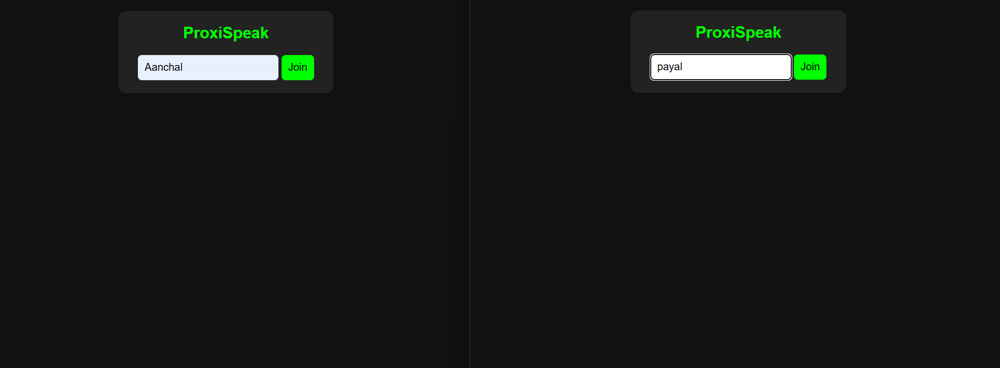
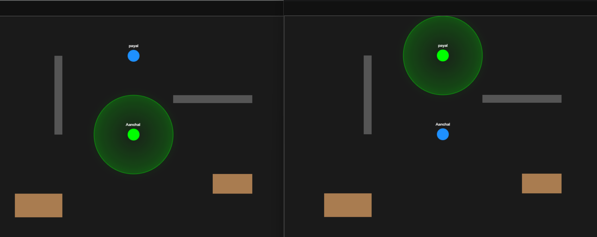

# 🎧 ProxiSpeak Frontend

> A 2D virtual office where you hear people only when you walk close to them. 🚶‍♀️🔊

## 🌟 Overview
ProxiSpeak is a 2D virtual office where users move their avatars around a shared map. When two users come within **100 pixels** of each other, they enter each other's **hearing zone**, which is the basis for proximity-based audio.

## ✨ Features
| Feature | Details |
|---|---|
| 🔐 Login | Username-based login screen |
| 🕹️ Movement | WASD / Arrow keys on HTML5 Canvas |
| 👥 Multiplayer | Live avatars using Socket.io |
| 🔵 Hearing Zone | Glowing 100px zone around the player |
| 🏢 Office Layout | Walls, desks, tables, sofa and plants |
| 🚧 Collision | Wall and furniture collision detection |
| ⚡ Animation | Smooth 60 FPS using requestAnimationFrame |
| 💡 Highlight | Nearby users highlighted inside the hearing zone |

## 🛠️ Tech Stack
HTML5 Canvas, JavaScript, Socket.io client

## 📁 Folder Structure
- `index.html`: login screen and canvas
- `app.js`: game logic, movement, rendering, socket events
- `style.css`: styling
- `utils.js` / `utils.test.js`: helper functions and unit tests

## 🚀 Setup and Run
1. Start the backend: `cd backend_p`, then `npm install`, then `node server.js`
2. Open `frontend/index.html` in a browser
3. Enter a username and click **Join**
4. To test multiplayer, open the page in two tabs with different usernames

## 🔌 Socket Events Used
| Event | Purpose |
|---|---|
| `join-space` | Sent when a user joins |
| `move` | Sends the player's current position to the server |
| `user-joined` | A new user has joined |
| `user-moved` | Another user's position was updated |
| `user-left` | A user has disconnected |

## 📸 Screenshots
### Login Screen

### Office Map with Hearing Zone

Two users inside each other's 100px hearing zone are highlighted on the map.

## 🧪 Running Tests
Run `npm test` inside the frontend folder to run the unit tests in `utils.test.js`.

## 📅 Progress
- ✅ **Week 3:** Smooth movement with lerp and throttled emit, unit tests
- ✅ **Week 4:** Walls, furniture, collision detection, glowing hearing zone, screenshots

## 🔮 Future Plans
- Proximity-based voice chat
- More rooms and avatars
